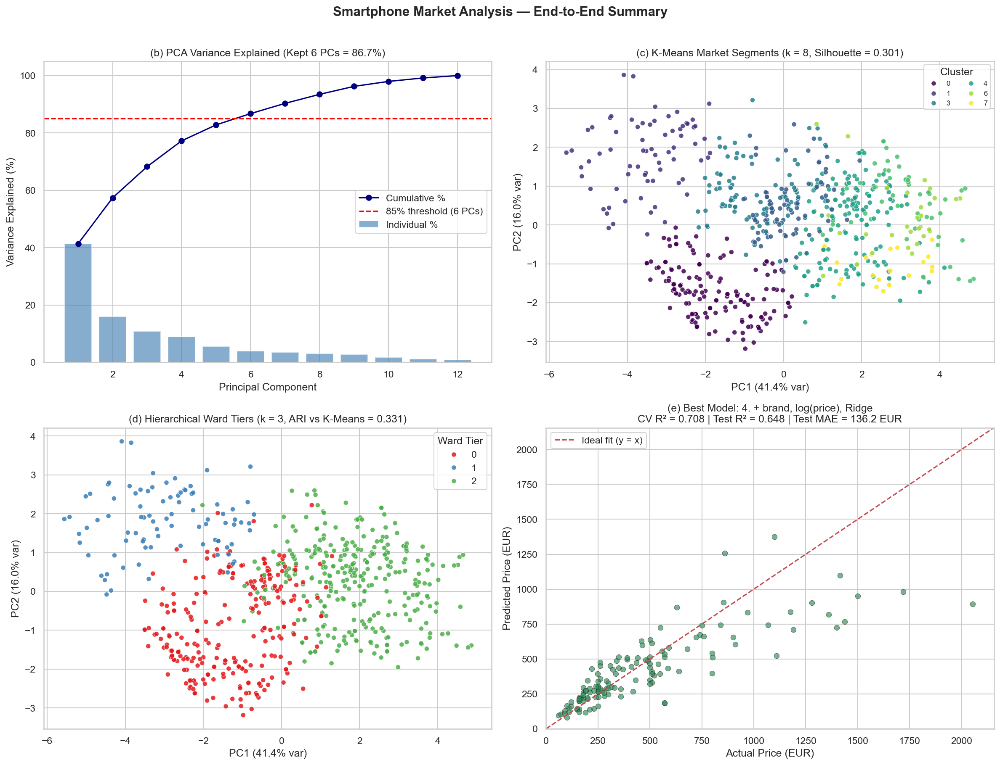

# 📱 Smartphone Specifications & Price Prediction Analysis

An end-to-end data science project analyzing smartphone hardware specifications scraped from **GSMArena** (`gsmarena.com`). The pipeline covers web scraping, data cleaning, domain feature engineering, KNN imputation, dual-method outlier treatment, **PCA**, **K-Means & Agglomerative Hierarchical Clustering**, and a strictly leakage-free **Linear / Ridge Regression** model for retail price prediction.



---

## 📊 Key Results Summary

| Stage | Method / Configuration | Key Outcome |
| :--- | :--- | :--- |
| **Dataset** | Web-scraped from GSMArena (16 brands, Nov 2026) | **938** raw devices → **657** modern smartphones (2018–2026) with verified EUR prices |
| **Imputation & Outliers** | Standardized **KNN (`k = 5`)** + Dual **IQR & Z-score** rules | Zero rows dropped; empirically validated via 20-round 10% masking test |
| **PCA** | Standardized 12 continuous hardware specs | **6 Principal Components** explain **86.75%** of total variance (Kaiser = 4 PCs) |
| **K-Means Clustering** | Unsupervised clustering on 6 PCA components | **`k = 8` market segments** (Silhouette = **0.301**) |
| **Hierarchical Clustering** | Ward linkage dendrogram cut at largest merge gap | **`k = 3` macro-tiers** (Budget, Midrange, Flagship; ARI vs. K-Means = **0.331**) |
| **Price Prediction** | Leakage-free **Ridge Regression on `log(price)`** + Brand | **5-Fold CV R² = 0.708** (`MAE = €117.65`) \| **Test R² = 0.648** (`MAE = €136.19`) |

---

## 🗂️ Repository Structure

```text
gsmarena-smartphone-analysis/
├── data/
│   ├── gsmarena_phones_raw.csv       # Raw scraped dataset (938 devices across 16 brands)
│   └── gsmarena_phones_clean.csv     # Cleaned dataset after filtering, KNN imputation & capping
├── figures/                          # High-resolution plots generated by the notebook
├── scraper/
│   └── scrape_gsmarena.py            # Polite BeautifulSoup scraper (5–9s request delay)
├── notebook.ipynb                    # Complete end-to-end analysis notebook
├── Smartphone_Specs_Data_Science_Report.docx  # Detailed project report
└── README.md
```

---

## 🔍 Methodology Breakdown

1. **Data Cleaning & Target Standardization:**
   * Filtered out non-phone devices (smartwatches, tablets, feature phones) and pre-2018 models (`938 → 802` smartphones).
   * Standardized on GSMArena-listed **EUR** prices (`657` phones) to avoid exchange-rate distortion across regional listings (`USD/EUR` ratios spanned `0.47` to `6.87`).
2. **Feature Engineering & Preprocessing:**
   * Extracted domain signals from text columns: `is_foldable`, `is_pro_ultra`, `is_flagship_chip`, `chip_nm` (lithography node), and `is_discontinued`.
   * Filled omitted `refresh_hz` blanks with `60 Hz` (GSMArena's baseline convention) and imputed remaining missing specs using standardized **KNN (`k = 5`)**.
3. **Dimensionality Reduction & Market Segmentation:**
   * Compressed 12 standardized continuous specs into **6 uncorrelated PCs (`86.75%` variance)**.
   * Clustered phones purely on hardware specs (without exposing price or brand) via **K-Means (`k = 8`)** and **Ward Hierarchical Clustering (`k = 3`)**, recovering natural budget-to-flagship tiers.
4. **Leakage-Free Price Prediction:**
   * Reverted to the pre-imputation snapshot (`df_unimputed`), performed an **80/20 train-test split** (`525` train / `132` test) *before* any statistical transformations, and fitted `StandardScaler` and `KNNImputer` inside `scikit-learn` pipelines across 5-fold cross-validation.

### Regression Model Progression

| Model | 5-Fold CV R² | CV MAE (EUR) | Test R² | Test RMSE (EUR) | Test MAE (EUR) |
| :--- | :---: | :---: | :---: | :---: | :---: |
| **1. Specs + engineered tiers (baseline)** | 0.628 | 144.79 | 0.587 | 238.49 | 158.77 |
| **2. + Brand (one-hot encoded)** | 0.659 | 143.23 | **0.670** | **213.25** | 146.61 |
| **3. + Brand, `log(price)`** | 0.705 | 118.39 | 0.653 | 218.49 | **135.78** |
| **4. + Brand, `log(price)`, Ridge** | **0.708** | **117.65** | 0.648 | 220.22 | 136.19 |

---

## 🚀 How to Run

```bash
# Clone the repository
git clone https://github.com
cd gsmarena-smartphone-analysis

# Install dependencies
pip install numpy pandas matplotlib seaborn scikit-learn scipy beautifulsoup4 requests

# Run the analysis notebook
jupyter notebook
```